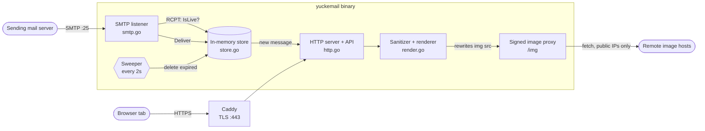
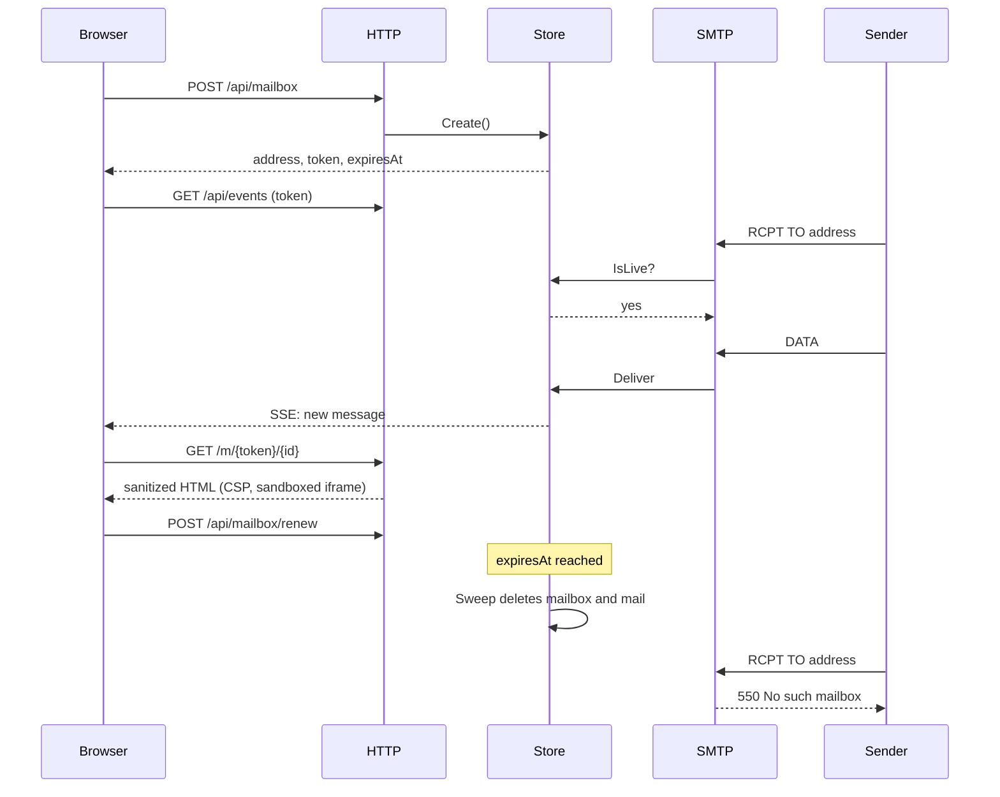

# yuckemail architecture

## Files
| File | Role |
|------|------|
| `main.go` | Flags, wiring, background sweeper and rate-limit pruning, graceful shutdown. |
| `smtp.go` | Accepts mail only for live addresses, parses MIME into a `Message`. |
| `store.go` | Mailboxes indexed by address and by token; delivery, renew, subscriptions, expiry. |
| `http.go` | Static site, JSON API, SSE stream, message rendering, per-IP rate limit. |
| `render.go` | HTML sanitizing, content CSP, HMAC-signed image proxy with SSRF guard. |
| `static/` | The single-page UI (embedded into the binary). |

## Lifecycle of a mailbox

## HTTP routes
| Route | Purpose |
|-------|---------|
| `POST /api/mailbox` | Create a mailbox (rate-limited). Returns address and token. |
| `GET /api/mailbox` | Snapshot of the mailbox for the bearer token. |
| `POST /api/mailbox/renew` | Reset the countdown. |
| `GET /api/events` | Server-Sent Events stream of new messages. |
| `GET /m/{token}/{id}` | Rendered message body for the iframe. |
| `GET /m/{token}/{id}/cid/{cid}` | Inline image parts. |
| `GET /img` | Signed remote-image proxy. |
| `GET /healthz` | Liveness and live mailbox count. |
